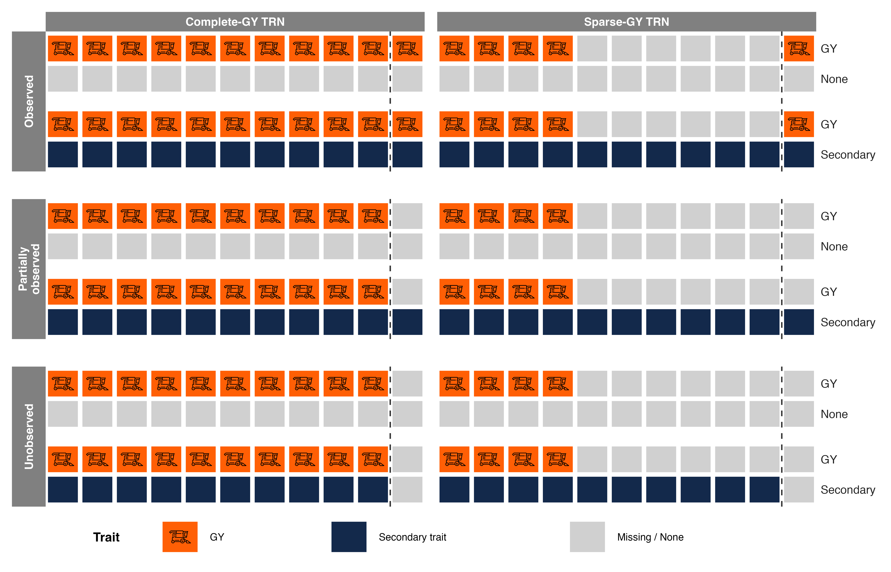

# Imputed Grain Yield as a Secondary Trait in Genomic Selection

Reproducible R code for analyses associated with the manuscript **“Imputed Grain Yield Used as a Secondary Trait in Multi-Trait Genomic Selection Can Improve Selection Accuracy Among Imputed Candidates.”**

This repository contains multi-trait, multi-environment (MTME) genomic prediction models comparing observed grain yield (GY) alone with GY analyzed jointly with imputed GY or remotely sensed secondary traits. The analyses examine the effects of training-data availability and candidate phenotyping on genomic prediction.

> **Reproducibility status:** The scripts and data must be checked against the final manuscript analyses before declaring the results reproduced. In particular, confirm the candidate-masking rules, filtering of imputation methods, and timing of phenotype standardization.

## Analysis overview

### Traits and models

| Model | Responses | Factor-analytic rank used in the supplied scripts |
| --- | --- | --- |
| GY-only | Observed grain yield | FA2 |
| GY + IGY (MLR) | GY and multiple-linear-regression-imputed GY | FA4 |
| GY + IGY (MF) | GY and missForest-imputed GY | FA5 |
| GY + NDRE | GY and normalized difference red edge index | FA5 |
| GY + PC1 | GY and the first principal component of vegetation indices (NDVI, GNDVI, and NDRE) | FA5 |

The models include a genomic factor-analytic term across trait-environment combinations, additional diagonal genomic and non-genomic genetic terms, block effects, and an AR1-by-AR1 spatial residual structure within each trait-environment. Scripts use **ASReml-R**.

### Training designs

- **Complete-GY:** Uses the available GY training phenotypes without additional sparse-zone masking.
- **Sparse-GY:** Additionally masks GY observations in predefined sparse training zones (`mask_zone`), where specified by the script.

### Prediction scenarios

| Scenario | GY in selection candidates | Secondary phenotype in selection candidates |
| --- | --- | --- |
| Observed | Available where originally measured | Available where originally measured |
| Partially observed | Masked | Retained where available |
| Unobserved | Masked | Masked |

In GY-only models, the secondary-phenotype column does not apply. These descriptions state the intended scenario definitions; verify that individual scripts implement them and that prediction evaluation is independent of fitting observations where required.

### Experimental design schematic



**Figure 1.** Schematic of the phenotypic information available under the Complete-GY and Sparse-GY training designs and the three candidate-observation scenarios. Each pair of rows represents grain yield (GY) only or GY combined with a secondary trait (NDRE, PC1, IGYMF, or IGYMLR). The complete-GY TRN retained all training GY records, whereas sparse-GY retained 40%; secondary-trait records remained fully available. Colored tiles denote observed records: GY (orange; harvester), blue tiles indicate observed secondary trait, and gray tiles indicate missing records. Each of the ten training tiles represents 10% of the TRN records, whereas the candidate tile represents the fixed set of 100 lines. The dashed line separates the training and selection candidate sets.

## Repository organization

```text
ImputedGY-SecondaryTrait-GS/
├── README.md
├── .gitignore
├── Figures/
│   └── Figure3_simplified.png
├── IGY-SecondaryTrait-GS.Rproj
├── R/
│   ├── Functions_earlyGS.R
│   └── *.R                         # Model-fitting scripts
├── Data/
│   ├── Ginv.rds
│   ├── selection_candidates.csv
│   ├── Pheno_CompleteGY_Observed.rds
│   ├── Pheno_CompleteGY_Unobserved.rds
│   ├── Pheno_SparseGY_Observed.rds
│   ├── Pheno_SparseGY_Unobserved.rds
│   ├── Pheno_ndre.rds
│   └── Pheno_PC1.rds
└── Results/                        # Generated outputs (not versioned)
```

The tree describes the expected layout; not all example files or scenarios necessarily exist in every revision. Input data distribution and permissions should be verified before publishing.

## Requirements

- R with support for the base pipe (`|>`), plus **tidyverse** and **here**.
- **ASReml-R**, installed and licensed separately; it is commercial software and is not included in this repository.
- Any additional R packages required by `R/Functions_earlyGS.R`.
- Enough memory for the chosen model; script `workspace` arguments commonly range from 4 GB to 8 GB, but total process memory may exceed those values.

Install open-source dependencies with:

```r
install.packages(c("tidyverse", "here"))
```

Check the ASReml-R installation and license using the software's official installation instructions.

## Running a model

1. Clone or download the repository, preserving the directory structure.
2. Make sure required input files are available under `Data/` and the ASReml-R license works.
3. Open `IGY-SecondaryTrait-GS.Rproj` in RStudio, or run a script from the project root:

```bash
Rscript R/GYonly_CompleteGY_Unobserved.R
```

The model scripts use `here()` for portable paths. Example output:

```text
Results/GYonly_CompleteGY_Unobserved_FA2.rds
```

Load a saved model using:

```r
model <- readRDS(here::here("Results", "GYonly_CompleteGY_Unobserved_FA2.rds"))
```

Some scripts additionally save summary or variance-component objects. Output files under `Results/` should not be committed to Git.

## Input data and masking

- `Ginv.rds`: inverse genomic relationship matrix used in `vm()` terms.
- `selection_candidates.csv`: genotype identifiers (`Gen`) for candidates whose phenotypes are masked under the appropriate scenarios.
- `Pheno_*.rds`: prepared phenotype tables containing trait, environment, genotype, spatial position, and response columns, as required by each model.
- `Pheno_ndre.rds` and `Pheno_PC1.rds`: prepared tables containing GY and the corresponding secondary trait.

Before fitting each model, inspect the retained trait-environment levels and number of nonmissing observations per trait and candidate status. Some source datasets contain **filler plots** with missing genotype and phenotype values; these records are intentionally retained in preprocessing to preserve the field layout. The handling of missing responses by the installed ASReml-R version should be checked.

For scripts using `TraitEnv` prefixes to exclude imputation methods, confirm the exact capitalization and trait labels. Also note that masking `Pheno_z` after pre-standardization is not necessarily equivalent to masking raw `Pheno` before standardization.

## Citation

If you use this repository, please cite the associated manuscript:

*Imputed Grain Yield Used as a Secondary Trait in Multi-Trait Genomic Selection Can Improve Selection Accuracy Among Imputed Candidates.*

Full publication details and DOI should be added when available.

## License and data availability

A code license and a definitive statement on whether all input data can be redistributed should be added before release. **Do not assume that the ASReml-R license permits redistribution of the software.**
